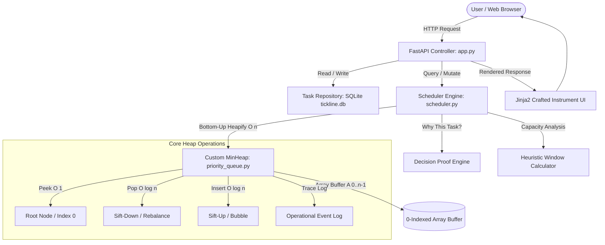

# PROJECT 17: TASK SCHEDULER WITH DEADLINES (TICKLINE)
## Advanced Data Structures Mini-Project Academic Technical Report

---

### 1. Executive Summary & Problem Statement

In academic, engineering, and operating systems environments, managing competing tasks with strict deadlines and varying priorities represents a fundamental scheduling problem. A simple First-In-First-Out (FIFO) queue or an unsorted backlog causes deadline inversions and priority violations. Conversely, maintaining a continuously sorted array imposes an unsustainable $\mathcal{O}(n)$ shift overhead per insertion or deletion.

**TICKLINE** is a specialized, deadline-aware scheduling instrument designed to organize and prioritize tasks according to deadlines and priority weights. At its computational core lies a custom **0-indexed Binary Min-Heap Priority Queue** engineered for transparent algorithm inspection, deterministic tie-breaking, and provable asymptotic guarantees.

#### Core Objectives
1. **Algorithmic Integrity**: Design and implement a transparent Binary Min-Heap Priority Queue from first principles in Python without relying on opaque library black boxes.
2. **Deterministic Multi-Tier Policy**: Enforce an Earliest Deadline First (EDF) policy with deterministic tie-breaking (Deadline $\rightarrow$ Priority $\rightarrow$ Creation Time $\rightarrow$ Task ID), alongside an alternate Priority-First policy.
3. **Transparent Decision Engine ("Why This Task?")**: Compute and display exact mathematical justifications for the top-ranked task, contrasting its composite key against runner-up contenders.
4. **Heuristic Capacity Estimation**: Provide capacity warnings comparing cumulative task effort against user-defined focus windows without claiming unverified global optimality.
5. **Algorithmic Laboratory**: Provide a live visualizer exposing the underlying array layout $A[0 \dots n-1]$, parent-child index arithmetic, invariant verification, and an operational trace buffer.
6. **Durable Persistence**: Persist state across application restarts using SQLite.

---

### 2. Data Structure Selection & Comparative Justification

The fundamental operation required by a task scheduler is repeatedly selecting and removing the highest-priority (earliest deadline) item, punctuated by dynamic insertions and modifications.

#### Comparative Asymptotic Complexity Matrix

| Data Structure | Peek Root | Insert Task | Extract Top | Build Collection | Arbitrary Search | Pointer / Memory Overhead | Cache Locality |
| :--- | :---: | :---: | :---: | :---: | :---: | :---: | :---: |
| **Unsorted Array** | $\mathcal{O}(n)$ | $\mathcal{O}(1)$ | $\mathcal{O}(n)$ | $\mathcal{O}(n)$ | $\mathcal{O}(n)$ | Minimal | High |
| **Sorted Array** | $\mathcal{O}(1)$ | $\mathcal{O}(n)$ | $\mathcal{O}(1)^*$ | $\mathcal{O}(n \log n)$ | $\mathcal{O}(\log n)$ | Minimal | High |
| **Singly/Doubly Linked List**| $\mathcal{O}(n)$ | $\mathcal{O}(1)$ | $\mathcal{O}(n)$ | $\mathcal{O}(n)$ | $\mathcal{O}(n)$ | High ($2\times$ pointers) | Poor |
| **Balanced BST (AVL / RB Tree)**| $\mathcal{O}(\log n)$ or $\mathcal{O}(1)^*$ | $\mathcal{O}(\log n)$ | $\mathcal{O}(\log n)$ | $\mathcal{O}(n \log n)$ | $\mathcal{O}(\log n)$ | High ($3\times$ pointers + balance)| Poor (Node pointers) |
| **Binary Min-Heap (TICKLINE)** | **$\mathcal{O}(1)$** | **$\mathcal{O}(\log n)$** | **$\mathcal{O}(\log n)$** | **$\mathcal{O}(n)$** | $\mathcal{O}(n)$ | **Zero pointer overhead** | **Optimal (Contiguous Buffer)** |

*\* Extracting from the head of a sorted array requires an $\mathcal{O}(n)$ left-shift unless implemented as a circular deque.*

#### Why a Binary Heap Over Balanced Search Trees (BST)?
1. **Space & Memory Overhead**: Balanced BSTs (AVL or Red-Black trees) require storing two child pointers, a parent pointer, and balance factor/color flags per node. In contrast, a binary heap is stored in a **contiguous, flat array** where structural relationships are computed purely via index arithmetic, resulting in zero pointer overhead.
2. **CPU Cache Locality**: Array elements reside contiguously in virtual memory, yielding high spatial cache locality and hardware prefetching efficiency. BST nodes are dynamically allocated across the heap, causing pointer chasing and cache misses.
3. **Optimal Construction Time**: A binary heap of $n$ elements can be built from an arbitrary list in strictly $\mathcal{O}(n)$ time using Floyd's bottom-up heapify algorithm, whereas balanced search trees require repeated insertions taking $\mathcal{O}(n \log n)$ time.
4. **Specialization for Root Retrieval**: A scheduler does not require arbitrary range queries (e.g., "find all tasks between May 4 and May 6"), which is the primary strength of BSTs. A priority queue strictly optimizes for $\mathcal{O}(1)$ inspection of the minimum key.

---

### 3. Mathematical Foundations & Heap Invariants

#### 3.1 0-Indexed Array Mapping Arithmetic
The complete binary tree is mapped into a 0-indexed sequential buffer $A[0 \dots n-1]$:
- **Root Element**: Located at index $0$.
- **Parent Index**: For any node at index $i > 0$:
  $$\text{Parent}(i) = \left\lfloor \frac{i - 1}{2} \right\rfloor$$
- **Left Child Index**:
  $$\text{LeftChild}(i) = 2i + 1$$
- **Right Child Index**:
  $$\text{RightChild}(i) = 2i + 2$$
- **Leaf Nodes**: All nodes with index $i \ge \left\lfloor \frac{n}{2} \right\rfloor$.
- **Tree Height**: For $n$ elements:
  $$h = \lfloor \log_2 n \rfloor$$

#### 3.2 Min-Heap Invariant
For every node at index $i > 0$:
$$\text{Key}(A[\text{Parent}(i)]) \le \text{Key}(A[i])$$
Consequently, the root node $A[0]$ is unconditionally the minimum element in the entire structure.

---

### 4. Algorithm Specifications & Pseudocode

#### 4.1 Sift-Up (Percolate-Up)
Restores the heap invariant after an element is appended at the end of the array.
```
algorithm SiftUp(heap, index):
    curr = index
    while curr > 0:
        parent = floor((curr - 1) / 2)
        if heap[curr].key < heap[parent].key:
            swap(heap[curr], heap[parent])
            curr = parent
        else:
            break
```
- **Comparisons**: At most $\lfloor \log_2 n \rfloor$.
- **Time Complexity**: $\mathcal{O}(\log n)$.

#### 4.2 Sift-Down (Percolate-Down)
Restores the heap invariant after the root is replaced by the last element during extraction.
```
algorithm SiftDown(heap, index, n):
    curr = index
    while true:
        left = 2 * curr + 1
        right = 2 * curr + 2
        smallest = curr
        
        if left < n and heap[left].key < heap[smallest].key:
            smallest = left
            
        if right < n and heap[right].key < heap[smallest].key:
            smallest = right
            
        if smallest != curr:
            swap(heap[curr], heap[smallest])
            curr = smallest
        else:
            break
```
- **Comparisons**: At most $2 \lfloor \log_2 n \rfloor$.
- **Time Complexity**: $\mathcal{O}(\log n)$.

#### 4.3 Floyd's Bottom-Up Heapify (Linear Time Build Heap)
Rather than inserting $n$ elements individually (which takes $\sum_{i=1}^n \log i = \mathcal{O}(n \log n)$), bottom-up heapify processes nodes backwards starting at the deepest non-leaf parent $\left\lfloor \frac{n - 2}{2} \right\rfloor$ down to index $0$:
```
algorithm BuildHeap(heap, n):
    start = floor((n - 2) / 2)
    for i from start down to 0:
        SiftDown(heap, i, n)
```

##### Mathematical Proof of $\mathcal{O}(n)$ Complexity:
At height $h$, there are at most $\left\lceil \frac{n}{2^{h+1}} \right\rceil$ nodes. The cost of sifting down a node at height $h$ is $\mathcal{O}(h)$. The total work is:
$$T(n) = \sum_{h=0}^{\lfloor \log_2 n \rfloor} \left\lceil \frac{n}{2^{h+1}} \right\rceil \mathcal{O}(h) \le c \cdot n \sum_{h=0}^{\infty} \frac{h}{2^h}$$
Using the standard identity $\sum_{h=0}^{\infty} \frac{h}{2^h} = 2$:
$$T(n) \le 2c \cdot n = \mathcal{O}(n)$$
Hence, construction is strictly linear.

---

### 5. Deterministic Comparator & Ordering Policy

To avoid ambiguous states or non-deterministic ordering, TICKLINE encapsulates task keys as composite lexicographical tuples.

#### Policy 1: Earliest Deadline First (EDF) [Default / Assessed]
$$\text{Key}(T) = \big( \text{ISO8601}(T.\text{deadline}),\; -T.\text{priority},\; \text{ISO8601}(T.\text{created\_at}),\; T.\text{task\_id} \big)$$
1. **Primary Key**: Deadline ascending. Tasks with earlier deadlines appear first.
2. **Tie-Breaker 1**: Inverted priority ($-T.\text{priority}$). For tasks with equal deadlines, higher priority (Level 5 vs Level 2) produces a smaller integer ($-5 < -2$), bubbling to the top.
3. **Tie-Breaker 2**: Creation timestamp ascending (FIFO). Breaks ties by whichever task was registered earlier.
4. **Tie-Breaker 3**: Stable alphanumeric task ID ascending (e.g. `TSK-101` $<$ `TSK-102`), guaranteeing total determinism.

#### Policy 2: Priority-First (Critical Hierarchy)
$$\text{Key}(T) = \big( -T.\text{priority},\; \text{ISO8601}(T.\text{deadline}),\; \text{ISO8601}(T.\text{created\_at}),\; T.\text{task\_id} \big)$$
Orders strictly by importance first, treating deadline as the secondary tie-breaker.

---

### 6. System Architecture & Workflows



#### Task Mutation & Heap Rebuild Flow
When a task is added, edited, or reopened:
1. The update is atomically committed to the SQLite repository (Source of Truth).
2. The scheduler queries all active tasks and invokes `heap.build_heap(items)`.
3. Bottom-up heapify runs in $\mathcal{O}(n)$ time, generating a verified, invariant-compliant binary tree.
4. The operational trace log records the exact number of comparisons and swaps performed.

---

### 7. Asymptotic Complexity Summary

| Operation | Time Complexity | Auxiliary Space | Explanation |
| :--- | :---: | :---: | :--- |
| **Peek Root (`peek`)** | $\mathcal{O}(1)$ | $\mathcal{O}(1)$ | Direct memory inspection of $A[0]$. |
| **Insert Task (`insert`)** | $\mathcal{O}(\log n)$ | $\mathcal{O}(1)$ | Appends to buffer, sifts up along tree height $\le \lfloor\log_2 n\rfloor$. |
| **Extract Min (`pop`)** | $\mathcal{O}(\log n)$ | $\mathcal{O}(1)$ | Swaps root with last element, sifts down $\le 2\lfloor\log_2 n\rfloor$ steps. |
| **Bottom-Up Heapify (`build_heap`)**| $\mathcal{O}(n)$ | $\mathcal{O}(1)$ | Sifts down non-leaf nodes; sum of heights converges to $2n$. |
| **Sorted Projection (`get_ranked_queue`)**| $\mathcal{O}(n \log n)$ | $\mathcal{O}(n)$ | Performs $n$ successive pops from a shallow copy of the heap. |
| **Heap Invariant Check** | $\mathcal{O}(n)$ | $\mathcal{O}(1)$ | Linear pass verifying parent $\le$ children for all $i < n$. |
| **Space Complexity** | $\mathcal{O}(n)$ | $\mathcal{O}(n)$ | Flat array containing $n$ element references. Zero pointer overhead. |

---

### 8. Verification & Test Suite Summary

A test suite comprising **23 automated tests** verifies all invariant contracts, comparator tie-breaking rules, persistence lifecycles, and HTTP endpoints:

| Test File | Test Cases | Objective / Verification |
| :--- | :---: | :--- |
| `tests/test_heap.py` | 7 | Verifies empty heap behavior, single element handling, invariant maintenance over randomized inputs, $\mathcal{O}(n)$ bottom-up heapify correctness, composite key tie-breaking, parent/child arithmetic, and array metadata indexing. |
| `tests/test_scheduler.py` | 6 | Validates Earliest Deadline First resolution, priority tie-breaking on identical deadlines, runtime policy switching to Priority-First, task completion/reopening flow, "Why this task?" explanation generation, and capacity warning calculations. |
| `tests/test_repository.py` | 4 | Tests atomic SQLite CRUD operations, model validation constraints (blank titles, nonpositive duration, priority bounds), seed/reset idempotency, and settings persistence. |
| `tests/test_api.py` | 6 | Verifies FastAPI HTTP route handling, redirects, template rendering for Workbench and Heap Lab, task creation flow, completion pops, and REST endpoints (`/api/queue`, `/api/heap`). |

---

### 9. Limitations & Industrial Scaling Considerations

1. **Heuristic vs Optimal Scheduling**: TICKLINE's "Next Up" selection selects the greedy optimal task according to the comparator. It makes no claim of solving the NP-hard multiprocessor scheduling or knapsack-constrained job-shop problem. Tasks may overlap, experience external blocking, or vary in actual completion time.
2. **Rebuild Strategy vs Indexed Heap**: For small to medium academic worklists ($n < 50,000$), rebuilding the heap via bottom-up heapify in $\mathcal{O}(n)$ is faster in practice and avoids stale index pointers. In industrial distributed systems ($n > 10^7$), an **Addressable / Indexed Priority Queue** with an auxiliary hash map ($\text{task\_id} \rightarrow \text{array index}$) enables arbitrary $\mathcal{O}(\log n)$ priority updates at the expense of pointer management.
3. **Preemption & Dependencies**: Real-time operating systems (e.g., FreeRTOS) utilize preemptive priority scheduling with topological sorting for directed acyclic graph (DAG) task dependencies.

